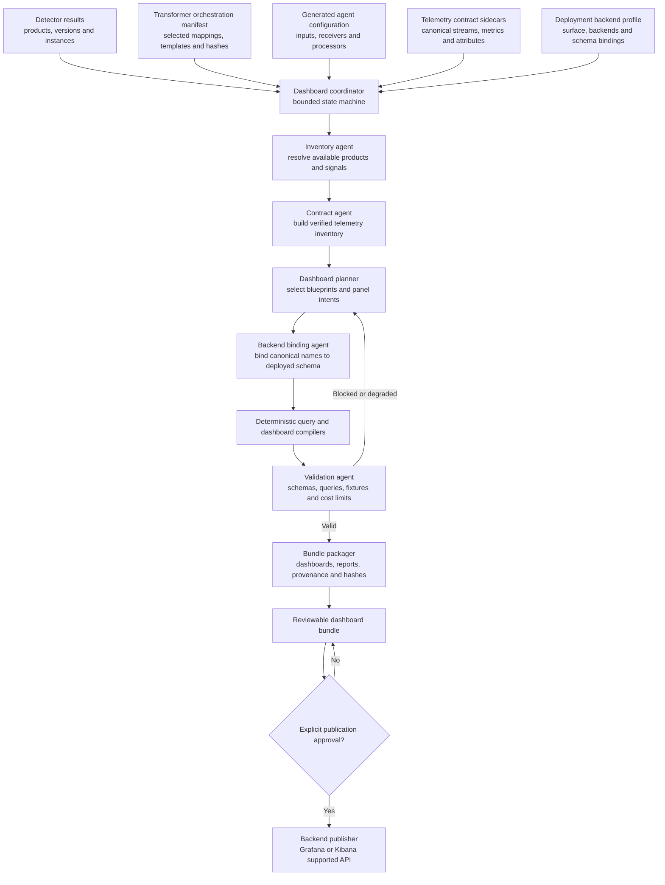

<!--
Copyright 2026 opamp.info
Licensed under the Apache License, Version 2.0.
-->

# Agentic adaptive dashboard generation proposal

## Objective

Create a bounded agentic workflow that takes detector results and transformer
outputs, determines which telemetry will actually exist, and produces a useful
set of dashboards for different storage/query backends and visualization
surfaces.

The same product intent should adapt to deployments such as:

- Grafana with Loki for logs and Prometheus for metrics;
- Grafana with ClickHouse for logs and metrics;
- Kibana with Elasticsearch for logs and metrics; and
- mixed deployments, such as Loki logs with ClickHouse metrics.

The system should omit unsupported panels, explain degraded coverage, validate
queries against the intended backend version, and package dashboards for review
before any production publication.

## Important distinction: backend versus dashboard surface

The telemetry backend stores and queries data. The dashboard surface renders
panels and manages dashboard objects. They must be modeled separately.

| Signal backend | Query form | Typical dashboard surface |
| --- | --- | --- |
| Loki logs | LogQL | Grafana |
| Prometheus metrics | PromQL | Grafana |
| ClickHouse logs or metrics | SQL through a ClickHouse data source | Grafana or another SQL-capable surface |
| Elasticsearch logs or metrics | Elasticsearch queries, ES|QL, KQL, or aggregation requests depending on the panel | Kibana |

Loki does not provide the dashboard UI itself; Grafana is the normal
visualization layer. Prometheus has a query UI, but the reusable dashboard
artifact in this proposal is normally a Grafana dashboard. ClickHouse can serve
multiple signals, but a dashboard compiler still needs the actual table schema
and the installed visualization plugin. Kibana dashboards depend on data views
and saved or API-managed objects, not only an Elasticsearch URL.

Backend and surface versions are part of compatibility. The generator must not
assume that a Grafana dashboard JSON model or Kibana object exported from one
version is portable to every other version.

## Why transformer YAML is not enough

The current transformer output provides valuable facts:

- selected detector, mapping, template, and target-agent versions;
- generated input or receiver configuration;
- signals and capabilities declared by template metadata;
- artifact paths and SHA-256 hashes; and
- target-specific composition instructions.

That output describes collection, but it does not fully describe the data after
ingestion. A dashboard also needs:

- canonical stream and metric identities;
- field, attribute, label, and resource names;
- metric type and unit;
- parsing and processor effects;
- destination index, stream, database, table, or metric-name bindings;
- timestamp and severity conventions;
- expected dimensions and safe groupings;
- visualization-surface and data-source identities; and
- evidence that the selected fields exist in the deployed backend.

Generated YAML may be inspected as a verification input, but it should not be
the semantic source of truth. Inferring all dashboard fields from arbitrary
plugin parameters and Jinja output would be brittle and would encourage agents
to invent unsupported queries.

## Proposed architecture

Add a dashboard-generation stage after configuration rendering and before
optional publication:



The workflow is agentic where semantic judgment is useful, but deterministic
where correctness is testable. Agents select contracts, explain tradeoffs, and
propose panel intent. Versioned compilers own LogQL, PromQL, SQL, Elasticsearch,
Grafana, and Kibana syntax. Validators, not model confidence, determine whether
an artifact is publishable.

## New contracts

### Telemetry contract

Every mapping should reference a versioned telemetry contract sidecar. The
transformer should copy its identity and hash into the orchestration manifest.
A future contract might contain:

```yaml
api_version: opamp.info/v1alpha1
kind: TelemetryContract
metadata:
  name: nginx_observability
  version: 1.0.0
spec:
  product: nginx
  streams:
    - id: nginx.access
      signal: logs
      format: nginx_access
      resource_attributes:
        - service.name
        - service.instance.id
        - host.name
      fields:
        - name: http.response.status_code
          type: integer
        - name: http.request.method
          type: string
        - name: url.path
          type: string
    - id: nginx.error
      signal: logs
      format: nginx_error
  metrics:
    - id: nginx.requests
      instrument_type: counter
      unit: "{request}"
      dimensions:
        - service.instance.id
```

Names should follow stable conventions where those conventions apply. The
[OpenTelemetry Semantic Conventions](https://opentelemetry.io/docs/specs/semconv/)
provide common resource, log, metric, trace, attribute, type, and unit meanings.
Product-specific names remain allowed when no stable convention expresses the
same meaning, but their ownership and version must be explicit.

The contract describes what the generated collection pipeline is intended to
emit after parsing and processing. Tests must verify that the real agent output
matches it.

### Deployment backend profile

A deployment-owned profile binds canonical telemetry to actual storage and
visualization systems:

```yaml
api_version: opamp.info/v1alpha1
kind: DashboardBackendProfile
metadata:
  name: production_grafana
spec:
  surface:
    type: grafana
    version: "12.4"
  signals:
    logs:
      backend: loki
      datasource_uid_ref: GRAFANA_LOKI_DATASOURCE_UID
      bindings:
        service.name: service_name
        service.instance.id: service_instance_id
    metrics:
      backend: prometheus
      datasource_uid_ref: GRAFANA_PROMETHEUS_DATASOURCE_UID
      bindings:
        nginx.requests: nginx_requests_total
```

The profile contains references to data-source identities, not passwords or
tokens. Environment or deployment-managed configuration resolves references at
publication time.

For ClickHouse, bindings additionally describe database, table, timestamp
column, value columns, attribute maps, and supported Grafana plugin version. For
Elasticsearch, they describe data views or index patterns, timestamp fields,
keyword/text variants, and surface-compatible query features.

### Dashboard blueprint

A backend-neutral blueprint expresses user intent without embedding LogQL,
PromQL, SQL, or Elasticsearch request bodies:

```yaml
api_version: opamp.info/v1alpha1
kind: DashboardBlueprint
metadata:
  name: nginx_overview
  version: 1.0.0
spec:
  product: nginx
  variables:
    - service.instance.id
    - host.name
  panels:
    - id: request_rate
      title: Request rate
      visualization: time_series
      requires:
        metrics:
          - nginx.requests
      query_intent:
        operation: counter_rate
        metric: nginx.requests
        group_by:
          - service.instance.id
      fallback:
        operation: log_event_rate
        stream: nginx.access
    - id: recent_errors
      title: Recent errors
      visualization: logs
      requires:
        logs:
          - nginx.error
      query_intent:
        operation: recent_events
        severity_at_least: error
```

The planner selects panels whose requirements can be satisfied. It may use a
declared fallback, such as deriving request rate from access logs when the
native metric is absent. It must not silently replace a metric with a different
meaning.

### Dashboard bundle manifest

Every generation run should produce a manifest recording:

- detector-result and transformer-manifest hashes;
- telemetry contract and blueprint versions;
- backend and surface profile versions;
- selected, omitted, degraded, and blocked panels with reasons;
- compiled query hashes and validation outcomes;
- generated dashboard and provisioning artifact hashes;
- required data sources, plugins, permissions, and external assets; and
- whether the bundle was only generated or was published.

## Agent roles and boundaries

### Dashboard coordinator

Runs an explicit state machine, passes versioned artifacts between roles, and
prevents a later agent from bypassing failed validation. It owns retry and
degradation policy but does not write backend-specific queries.

### Inventory agent

Reads detector results, the orchestration manifest, template metadata, and
generated configurations. It produces a normalized inventory of product
instances, configured signals, parsers/processors, and provenance. It treats
the manifest and file hashes as authoritative and reports inconsistencies.

### Contract agent

Resolves telemetry contract sidecars, checks that required attributes and
metrics are created by the selected mappings/processors, and applies approved
semantic conventions. Missing contracts block automatic dashboard generation
for that signal rather than triggering guessed field names.

### Dashboard planner

Selects product and fleet blueprints, variables, layouts, and panel intents. It
uses availability and importance rules to create a typical dashboard set while
recording omitted and degraded panels.

### Backend binding agent

Combines canonical telemetry names with the deployment backend profile. It may
use read-only schema discovery tools against an explicitly authorized backend.
It cannot discover or change credentials, create indices/tables, or modify data
sources.

### Query and surface compilers

These should be deterministic libraries, even if an agent chooses which
compiler to invoke:

- LogQL compiler for Loki log and log-derived metric intents;
- PromQL compiler for Prometheus metric intents;
- ClickHouse SQL compiler for bound table schemas;
- Elasticsearch/Kibana compiler for supported query and visualization objects;
- Grafana dashboard JSON compiler; and
- Kibana dashboard-as-code or import artifact compiler.

The model supplies a typed query intent. It does not concatenate arbitrary
query text.

### Validation agent

Runs schema, compatibility, query, result-shape, cost, and regression checks.
It can send read-only queries to disposable test backends or explicitly
authorized validation environments. Production data sampling is opt-in and
must enforce time, row, byte, and redaction limits.

### Packager and publisher

The packager always creates a reviewable local bundle. The publisher is a
separate capability requiring explicit authorization, destination selection,
and credentials. Publication should support plan/diff, idempotent stable IDs,
conflict policy, and rollback metadata.

## Typical dashboard set

The planner should start from a small predictable set rather than generating a
large collection of speculative panels.

### Fleet or estate overview

- discovered product instances by type and version;
- collection/configuration health;
- log and metric ingest rate;
- instances with missing expected signals;
- agent errors, dropped records, and retry/backpressure indicators; and
- links to product detail dashboards.

### Product overview

- availability or process/service state;
- throughput or operation rate;
- error ratio and error count;
- latency where an appropriate distribution or duration field exists;
- saturation/resource indicators; and
- active instance, host, environment, and version variables.

### Product logs

- log volume over time;
- error/warning volume and ratio;
- recent error records;
- top normalized messages or categories where safe;
- relevant HTTP/database/application dimensions; and
- links from a chart point to filtered raw events.

### Product metrics

- golden signals appropriate to the product;
- resource and connection utilization;
- product-specific metrics; and
- annotations derived from restarts, configuration changes, or error events.

### Conditional database operations

Only when the telemetry contract confirms availability:

- slow-query count and duration distributions;
- top query fingerprints by total or mean time;
- active connections, locks, waits, cache behavior, and transaction rate; and
- clear notices when an extension, profiler, or permission is unavailable.

Full SQL or MongoDB operation text should not appear by default. Prefer query
identifiers or normalized fingerprints and preserve the redaction policy in the
bundle manifest.

## Backend adaptation

The same blueprint intent compiles differently for each backend:

| Intent | Loki | Elasticsearch/Kibana | Prometheus | ClickHouse |
| --- | --- | --- | --- | --- |
| Recent error logs | LogQL stream selector plus label/parser filters | Bound data view plus KQL, ES|QL, or supported search request | Not applicable | Parameterized SQL over the bound log table |
| Log event rate | LogQL range aggregation | Date histogram/aggregation over matching documents | Not applicable | Time-bucketed `count()` query |
| Counter rate | Only when represented as a log-derived metric | Aggregation only when stored metric documents preserve counter semantics | PromQL `rate`/aggregation compiled from metric metadata | Difference/rate SQL appropriate to the stored metric model |
| Slow-query table | Parsed log stream or structured events | Bound slow-query documents | Metric-only summary, not raw query rows | Parameterized SQL over a redacted slow-query table |

[LogQL](https://grafana.com/docs/loki/latest/query/) uses label selectors and
optional log pipelines, while [PromQL](https://prometheus.io/docs/prometheus/latest/querying/basics/)
operates on typed time series. The compilers must respect those different data
models rather than translating query strings mechanically.

The official Grafana ClickHouse data source supports metrics, logs, traces,
variables, and SQL-based queries, but compatibility depends on both Grafana and
plugin versions. The backend profile must record those versions and the actual
ClickHouse schema. See the
[Grafana ClickHouse data-source documentation](https://grafana.com/docs/plugins/grafana-clickhouse-datasource/latest/).

## Surface artifact generation

### Grafana

Generate:

- dashboard JSON with stable UIDs;
- folder/provider metadata;
- required data-source UID references;
- optional provisioning YAML; and
- a report of required plugins and minimum Grafana versions.

Grafana supports file-based provisioning for version-controlled data sources
and dashboards. Provisioned dashboards can be overwritten from their source,
so the bundle must distinguish generated/managed dashboards from user-owned
copies. See the
[Grafana provisioning documentation](https://grafana.com/docs/grafana/latest/administration/provisioning/).

### Kibana

Generate version-appropriate dashboard-as-code JSON or saved-object import
artifacts together with required data views and visualization references. Use
documented Kibana APIs; never write directly to the `.kibana` index. Dashboard
objects and related data views must be packaged consistently, and imports need
an explicit conflict/overwrite policy. See the
[Kibana dashboard import documentation](https://www.elastic.co/docs/explore-analyze/dashboards/import-dashboards)
and [Kibana API documentation](https://www.elastic.co/guide/en/kibana/current/apis.html).

## Validation gates

### Contract validation

- Validate detector, transformer manifest, telemetry contract, backend profile,
  blueprint, and bundle-manifest schemas.
- Verify every referenced artifact hash.
- Require compatible product, mapping, template, backend, plugin, and surface
  versions.

### Query validation

- Parse or lint generated query syntax.
- Resolve every field, label, metric, table, index, and data view through the
  backend binding.
- Use parameter binding or compiler-controlled escaping.
- Apply mandatory time filters and bounded result limits.
- Estimate or measure cardinality and query cost.
- Reject PromQL operations inconsistent with metric type, such as applying a
  counter rate to a gauge.

### Fixture and live validation

- Load sanitized representative telemetry into disposable Loki, Prometheus,
  Elasticsearch, and ClickHouse containers.
- Execute every generated query and validate its result shape.
- Import or provision dashboards into version-pinned Grafana/Kibana containers.
- Verify dashboards load without missing data-source or object references.
- Capture screenshots only as supplemental evidence; validate object and query
  semantics independently.

### Cross-backend parity

Equivalent panels should express the same intent, units, filters, and grouping
where backend capabilities permit. Exact numeric parity may be inappropriate
when sampling or storage models differ, so tests should define tolerances and
document known semantic differences.

### Security and privacy

- Keep credentials out of generated dashboards and manifests.
- Do not expose raw SQL, MongoDB operation text, tokens, or sensitive log fields
  by default.
- Allowlist query operations and backend schema-discovery calls.
- Enforce read-only validation identities.
- Limit time ranges, rows, bytes, execution time, and concurrent queries.
- Scan dashboard bundles for secrets before packaging or publication.

## Generation statuses

Each dashboard and panel should receive one status:

| Status | Meaning |
| --- | --- |
| `ready` | Required telemetry and backend bindings exist, and validation passed. |
| `degraded` | A declared fallback was used or some optional dimensions are absent. |
| `omitted` | Required telemetry is not configured; the panel was intentionally excluded. |
| `blocked` | Telemetry was expected, but a contract, binding, query, permission, or validation failed. |
| `suggested` | An agent proposed a new blueprint or binding that has not passed review and regression. |

No `suggested` artifact may be published automatically.

## Output bundle

Produce one deterministic archive per target surface/profile:

```text
dashboard-bundle.zip
  dashboard-bundle-manifest.json
  source/
    detector-results.sha256
    orchestration.json
    telemetry-contracts/
    backend-profile.redacted.yaml
  blueprints/
  compiled-queries/
  grafana/
    dashboards/
    provisioning/
  kibana/
    dashboards/
    data-views/
  validation/
    results.json
    junit.xml
    query-results-summary.json
  checksums.sha256
```

Only the directory relevant to the selected surface needs to be populated.
Backend credentials and sensitive sampled records must never enter the archive.

## Proposed repository structure

```text
dashboard-generator/
  pyproject.toml
  schemas/
    telemetry_contract.schema.json
    backend_profile.schema.json
    dashboard_blueprint.schema.json
    dashboard_bundle_manifest.schema.json
  blueprints/
    common/
    nginx/
    postgresql/
    mongodb/
  backends/
    loki/
    prometheus/
    elasticsearch/
    clickhouse/
  surfaces/
    grafana/
    kibana/
  src/dashboard_generator/
  tests/
```

Keep the generator a local, reviewable CLI initially. If it later exposes a
Python-served endpoint, name that component with the required `*-service`
suffix and preserve the same artifact contracts.

## Delivery phases

### Phase 1: contracts and a deterministic Grafana vertical slice

- Add telemetry-contract, backend-profile, blueprint, and bundle schemas.
- Enrich NGINX and PostgreSQL mappings with telemetry contract references.
- Implement Grafana dashboard compilation for Loki logs and Prometheus metrics.
- Produce fleet, NGINX, PostgreSQL, and collection-health dashboards.
- Validate in version-pinned Grafana, Loki, and Prometheus containers.

### Phase 2: ClickHouse binding

- Define log and metric table-binding contracts.
- Implement parameterized ClickHouse SQL intent compilers.
- Require and validate the Grafana ClickHouse plugin/version profile.
- Run the same blueprints against ClickHouse fixtures and compare intent parity.

### Phase 3: Elasticsearch and Kibana

- Define data-view/index bindings and supported query modes by stack version.
- Implement versioned Kibana dashboard/data-view artifact generation.
- Validate imports and query execution in Elasticsearch/Kibana containers.
- Add conflict, stable-ID, and rollback behavior.

### Phase 4: bounded agentic planning

- Add agents for inventory, contract reconciliation, blueprint selection, and
  coverage explanations.
- Keep query and dashboard rendering deterministic.
- Allow new panel suggestions only as non-publishable review artifacts.
- Evaluate agent decisions against curated product/backend scenarios.

### Phase 5: controlled publication and operations

- Add plan/diff and explicitly authorized publishing.
- Track managed object identities and last published hashes.
- Support rollback/export of the previous managed dashboard set.
- Integrate dashboard bundles with the regression evidence archive and mapping
  version audit.

## Acceptance criteria

- The same backend-neutral blueprint can produce validated Grafana/Loki,
  Grafana/Prometheus, Grafana/ClickHouse, or Kibana/Elasticsearch artifacts when
  its required telemetry exists.
- Every panel traces to detector evidence, a transformer artifact, a telemetry
  contract, a blueprint intent, and a backend binding.
- Missing telemetry causes an explicit degraded/omitted/blocked result rather
  than a broken empty panel or invented field.
- Model-generated free-form backend queries cannot reach publication.
- All compiled queries run successfully against representative containerized
  fixtures and stay within configured cost limits.
- Dashboard bundles contain schemas, hashes, validation results, requirements,
  and no credentials or sensitive sampled payloads.
- Publication is a separate, idempotent, explicitly authorized operation with
  plan/diff and rollback information.

## Open decisions

- Whether telemetry contracts live beside agent mappings or in a shared
  product-level catalogue referenced by multiple agents.
- Whether one blueprint targets all visualization surfaces or surface-specific
  layout overlays are required.
- Which Grafana and Elastic/Kibana version families define the first support
  boundary.
- Which canonical NGINX, PostgreSQL, and MongoDB metrics and attributes are
  guaranteed by collection mappings.
- How much read-only schema discovery is permitted against production backends.
- Whether dashboard publication belongs in this repository or remains an
  output consumed by a separate deployment system.
