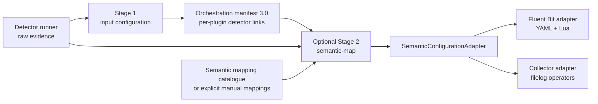

<!--
Copyright 2026 opamp.info
Licensed under the Apache License, Version 2.0.
-->

# Semantic payload mapping

## Purpose

The configuration pipeline has an optional second stage that turns a detected
source and its generated input plugin into an agent-specific configuration
which parses source records into an OpenTelemetry-shaped log payload. The
stage initially supports Fluent Bit 5.x and OpenTelemetry Collector Contrib
0.163 or later. NGINX access and error logs and PostgreSQL stderr and CSV logs
have maintained mappings.

This is deliberately a configuration generator, not a detector-side payload
parser. A detector reports evidence without changing it. The first transformer
stage is the earliest point at which an input plugin exists, so that stage
records the exact human- and machine-readable link from each plugin back to
the detector query row. The second stage verifies and consumes that link.

OpenTelemetry defines generic log attributes such as `log.record.original` and
`log.file.name`, stable HTTP vocabulary such as `http.request.method`,
`http.response.status_code`, `client.address`, and `url.path`, and the stable
PostgreSQL value `db.system.name=postgresql`. The maintained mappings use those
names where the source field has the same meaning. Product-only fields remain
under the `nginx.*` namespace rather than being presented as standard
OpenTelemetry fields. See the OpenTelemetry
[general log attributes](https://opentelemetry.io/docs/specs/semconv/general/logs/),
[HTTP server attributes](https://opentelemetry.io/docs/specs/semconv/http/http-spans/),
[PostgreSQL conventions](https://opentelemetry.io/docs/specs/semconv/db/postgresql/),
and [attribute naming guidance](https://opentelemetry.io/docs/specs/semconv/general/naming/).

## End-to-end flow



The boundary between stages is intentional:

1. The detector runner writes raw, schema-valid osquery evidence.
2. The normal transformer selects compatible agent mappings and writes source
   input configuration.
3. Manifest version 3.0 records every generated plugin and its detector link.
4. `semantic-map` verifies the detector-result SHA-256 from the manifest.
5. It selects one semantic mapping for every plugin with an explicit
   `source_format`.
6. A target adapter generates the final parsing and payload configuration.
7. A separate semantic manifest records source hashes, selected mapping hashes,
   the semantic-conventions version, generated files, and their hashes.

Plugins whose format remains `unstructured` are intentionally skipped. This is
how metrics inputs and unknown log formats avoid accidental parsing.

## Per-plugin detector provenance

Every stage-one artifact contains a `plugins` array. Each entry contains:

| Field | Purpose |
|---|---|
| `plugin_id` | Stable detector/rule name plus a digest prefix. |
| `source_format` | Machine-readable mapping selector such as `nginx.auto`. |
| `human_link` | Operator-readable explanation of how the plugin was selected. |
| `detector_link` | Exact detector URI, for example `detector://nginx_1/1.0.0/nginx_logs/0`. |
| `rule_name` | Stage-one transform rule. |
| `source_selector` | JSONPath selection and zero-based selected-row index. |
| `source_index` | Machine-readable selection index. |
| `properties` | Normalized plugin properties passed to the first template. |
| `configuration_sha256` | Digest of the normalized plugin properties. |

The generated configuration continues to have an artifact-level provenance
banner. The plugin records add the detail required to explain one input among
many inputs in the same artifact. Duplicate plugin configurations retain the
first deterministic detector link because the first stage already
deduplicates identical inputs.

The optional `path_match` on a stage-one rule prevents one detector field that
contains a human-readable list of candidates from becoming a file input. The
NGINX mappings use it to accept individual access and error log paths while
rejecting the detector's semicolon-separated explanatory candidate value.

## Semantic mapping contract

Files below `transformers/config-template-transformer/semantic-mappings/` are
validated `OpenTelemetrySemanticMapping` JSON resources. A mapping declares:

- compatible detector identity and version range;
- one or more accepted source format hints;
- an optional path regular expression and a selection priority;
- the OpenTelemetry semantic-conventions version;
- a neutral `regex` or `csv` parser definition;
- timestamp and severity fields when present;
- a source field to use as the log body;
- parsed-field to semantic-attribute mappings; and
- static resource and log-record attributes.

Automatic selection requires detector, detector version, source format, and
path predicate to match. The unique highest-priority mapping wins. A tie is an
error, as is a formatted plugin for which no mapping exists. This fail-closed
behavior prevents an access log from silently receiving an error-log parser.

The mapping is neutral. Agent syntax is not stored in it. Fluent Bit converts
the neutral regular-expression group syntax to its parser syntax and emits a
Lua payload mapper. Collector emits filelog receiver operators. This keeps the
meaning of a field in one place while allowing each agent to use its native
configuration model.

## Initial mappings

| Mapping | Automatic discriminator | Main semantic output |
|---|---|---|
| `nginx_access_combined` | NGINX access/request `.log` path | HTTP method, status, client address, URL, protocol, user agent, body size. |
| `nginx_error` | NGINX error `.log` path | Body, severity, process/thread IDs, NGINX connection ID. |
| `postgresql_stderr` | PostgreSQL stderr/default log source | Body, severity, process ID, database namespace and user. |
| `postgresql_csvlog` | `.csv` or `csvlog` path | CSV fields including operation, query text, SQLSTATE, client, database, user and process. |

NGINX combined-log parsing assumes the conventional combined format.
PostgreSQL stderr parsing assumes the documented default-style prefix represented
by the mapping. Real deployments can change `log_format`, `log_line_prefix`,
`log_destination`, and CSV columns. The detector cannot infer all of those
values from process and file evidence, so a deployment-specific mapping may be
required.

## Manual mappings

Pass `--mapping` one or more times instead of `--mapping-root` to use an
explicitly reviewed mapping set. This is the supported override for a custom
NGINX `log_format`, PostgreSQL `log_line_prefix`, a nonstandard file name, or a
source whose exact format cannot be discovered safely.

Start by copying the closest maintained JSON mapping. Give it a new name and
version, narrow its detector and source constraints, update the parser and
field mappings, and remove or adjust `path_regex` only when the deployment
owns that decision. An explicit set must still contain one unambiguous mapping
for every formatted input in the first-stage manifest.

Mapping files are data, not executable templates. JSON Schema rejects unknown
fields and unsafe ambiguity is rejected during selection. The generated Lua is
built from validated scalar values and field mappings; mapping files cannot
provide arbitrary Lua source.

## Agent implementations

`SemanticConfigurationAdapter` is the common abstract interface. Its
`generate()` method accepts verified `SemanticPlugin` records and returns
one or more path, media-type, and byte-content artifacts.

The Fluent Bit implementation emits:

- `generated/fluent-bit/semantic-normalization.yaml` with one input and parser
  per plugin and one Lua filter per unique tag; and
- `generated/fluent-bit/semantic-normalization.lua`, which creates `body`,
  `attributes`, and `resource` objects and includes the plugin and detector
  provenance attributes.

The semantic fragment replaces the source-only stage-one inputs; do not load
both sets of inputs or the same files will be collected twice. Mount the Lua
file at `/etc/fluent-bit/generated/semantic-normalization.lua`, or adjust the
deployment path consistently.

The Collector implementation emits
`generated/otelcol-contrib/semantic-normalization.yaml`. Each plugin becomes a
filelog receiver with native regex or CSV parsing, field moves, timestamp and
severity handling, semantic attributes, resource attributes, and provenance.
The generated log pipeline references those receivers. As with Fluent Bit,
use the semantic file instead of the source-only filelog fragments. Exporters
remain deployment policy and are supplied by another Collector configuration
file; `examples/otelcol_semantic_parent.yaml` provides a debug-only validation
example.

To add another agent, implement `SemanticConfigurationAdapter`, register it in
`get_semantic_adapter()`, add focused unit tests, and add container validation.
Detector and neutral mapping contracts do not change.

## Commands

First generate the normal Fluent Bit input configuration and manifest:

```powershell
obs-config-transformer render `
  --detector-results detector-results.json `
  --mapping-root transformers/config-template-transformer/mappings `
  --target-tool fluent-bit `
  --target-version 5.1.0 `
  --output-root build/generated `
  --manifest-output build/generated/orchestration-fluent-bit.json
```

Then run the optional semantic stage:

```powershell
obs-config-transformer semantic-map `
  --manifest build/generated/orchestration-fluent-bit.json `
  --detector-results detector-results.json `
  --mapping-root transformers/config-template-transformer/semantic-mappings `
  --output-root build/generated `
  --semantic-manifest-output build/generated/semantic-manifest-fluent-bit.json
```

For Collector, use `--target-tool otelcol-contrib` and an appropriate target
version in the first command. The second command determines the adapter from
the verified first-stage manifest.

For manual selection, replace `--mapping-root` in `semantic-map` with repeated
arguments such as:

```powershell
--mapping mappings/custom_nginx.json --mapping mappings/postgresql_csvlog.json
```

## Demonstration container

Run `tests/regression/run_regression.ps1` or
`tests/regression/run_regression_container.sh`. The container starts real NGINX
and PostgreSQL 17 processes, runs both detectors, renders source configurations
for Fluent Bit and Collector, runs semantic generation for both agents, and
validates all hashes and links.

The host-mounted `build/regression-artifacts/` directory exposes every phase:

- raw `detector-results.json`;
- agent-specific stage-one orchestration manifests and source fragments;
- stage-two semantic manifests;
- final Fluent Bit YAML and Lua artifacts;
- final Collector YAML;
- service logs and the regression verification report.

## Safety and known boundaries

- Detector-result and first-stage manifest hashes must match before generation.
- Output paths are constrained below the selected output root and written
  atomically.
- Mapping and manifest documents are JSON Schema validated.
- Mapping selection is deterministic and ambiguity is fatal.
- The stage generates collection-time normalization, not spans from access or
  database logs. HTTP and database attribute names describe parsed facts on log
  records; they do not turn those records into HTTP or database spans.
- Query text in PostgreSQL CSV logs can contain sensitive data. Retention,
  redaction, and export policy remain deployment responsibilities.
- Custom source formats require explicit tests with representative records.
