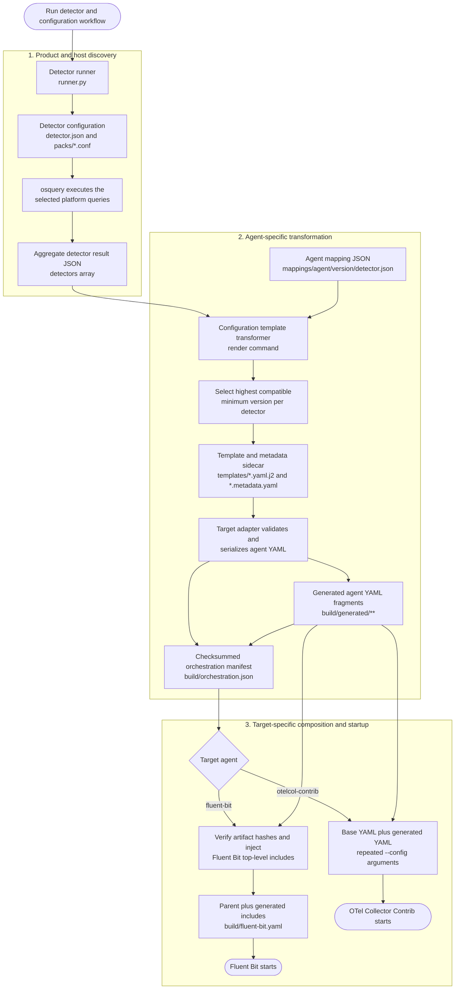

<!--
Copyright 2026 opamp.info
Licensed under the Apache License, Version 2.0.
-->

# Configuration generation execution flow

## End-to-end flow

This diagram shows the path from detector execution through deployment-ready
observability-agent configuration.

The detector runner and transformer remain separate processes. Detector results
are the versioned handoff between discovery and configuration generation; the
orchestration manifest is the checksummed handoff between generation and
deployment.

## Detailed transformer flow

This diagram expands the `render` command, including its explicit-definition
compatibility path and the normal agent-mapping path.

Any schema, path, JSONPath, version, template, size, plugin-count, or adapter
validation failure follows the error outcome and returns a non-zero CLI status.
Artifact files and the final manifest are written atomically.

## Configuration file relationships

This diagram shows which files are authored, which files are generated, and
how references connect them. Solid arrows represent runtime data or explicit
references. Dotted arrows represent schema validation.

```mermaid
flowchart LR
    subgraph detector_files["Detector-owned files"]
        detector_manifest["detectors/product/version/detector.json<br/>identity, platforms, pack and schema paths"]
        detector_pack["detectors/product/version/packs/platform.conf<br/>osquery SQL and output column aliases"]
        detector_schema["schemas/detectors/detector_name.schema.json<br/>detector-result contract"]
        aggregate_schema["schemas/detector_results.schema.json<br/>aggregate-result contract"]
        detector_results["detector-results.json<br/>generated aggregate evidence"]

        detector_manifest -->|selects| detector_pack
        detector_manifest -->|references| detector_schema
        detector_pack -->|produces query rows| detector_results
        detector_schema -. validates each entry .-> detector_results
        aggregate_schema -. validates aggregate .-> detector_results
    end

    subgraph mapping_files["Transformer-authored files"]
        mapping_schema["agent_mapping.schema.json"]
        mapping["mappings/agent/minimum_version/detector.json<br/>JSONPath rules, defaults, output and template reference"]
        transform_schema["transform_definition.schema.json"]
        manual_transform["examples/transforms/*.yaml<br/>optional manual-definition path"]
        metadata_schema["template_metadata.schema.json"]
        metadata["templates/name.metadata.yaml<br/>identity, version, capabilities and target range"]
        template["templates/name.yaml.j2<br/>agent YAML layout"]

        mapping_schema -. validates .-> mapping
        transform_schema -. validates .-> manual_transform
        mapping -->|names detector and version range| detector_results
        mapping -->|references template path and version| template
        mapping -->|references metadata path and version| metadata
        manual_transform -->|references template path and version| template
        manual_transform -->|references metadata path and version| metadata
        metadata_schema -. validates .-> metadata
        metadata -->|identifies and constrains| template
    end

    subgraph render_outputs["Render inputs and generated files"]
        render_command["obs-config-transformer render<br/>target tool, target version and output root"]
        generated_fragment["generated agent fragment<br/>for example nginx.inputs.yaml"]
        manifest_schema["orchestration_manifest.schema.json"]
        orchestration["orchestration.json<br/>versions, paths, hashes and composition strategy"]

        detector_results -->|--detector-results| render_command
        mapping -->|selected from --mapping-root| render_command
        manual_transform -->|alternative --definition input| render_command
        template -->|renders normalized plugin objects| render_command
        metadata -->|checked before rendering| render_command
        render_command -->|writes atomically| generated_fragment
        render_command -->|records artifact| orchestration
        generated_fragment -->|path and SHA-256| orchestration
        manifest_schema -. validates .-> orchestration
    end

    subgraph fluent_composition["Fluent Bit composition"]
        fluent_parent["examples/fluent_bit_parent.yaml<br/>deployment-owned parent"]
        inject_command["obs-config-transformer inject<br/>verifies manifest and artifact hashes"]
        assembled_fluent["assembled Fluent Bit YAML<br/>parent with top-level includes"]

        fluent_parent --> inject_command
        orchestration --> inject_command
        generated_fragment --> inject_command
        inject_command --> assembled_fluent
    end

    subgraph otel_composition["OpenTelemetry Collector composition"]
        otel_base["deployment-owned base Collector YAML"]
        otel_launch["deployment launcher<br/>builds repeated --config arguments"]
        otel_start["otelcol-contrib process"]

        otel_base --> otel_launch
        generated_fragment --> otel_launch
        orchestration -->|declares multiple_config_files strategy| otel_launch
        otel_launch -->|--config base --config generated| otel_start
    end
```

### File usage by stage

| File or hierarchy | Authored or generated | Used by | Purpose |
| --- | --- | --- | --- |
| `detectors/<product>/<version>/detector.json` | Authored | Detector runner | Identifies the detector, platform packs, result schema, and required queries. |
| `detectors/<product>/<version>/packs/<platform>.conf` | Authored | osquery | Defines the SQL that discovers processes, paths, ports, endpoints, and other evidence. |
| `schemas/detectors/*.schema.json` | Authored | Detector validation | Validates each detector's result entry. |
| Aggregate detector-result JSON | Generated | Transformer `render` command | Supplies the product evidence selected by mapping JSONPath rules. |
| `mappings/<agent>/<minimum_version>/<detector>.json` | Authored | Mapping selector and orchestrator | Connects detector fields to plugin attributes, defaults, processors, output paths, and templates. |
| `templates/*.yaml.j2` | Authored | Sandboxed Jinja renderer | Defines the target agent's YAML layout. |
| `templates/*.metadata.yaml` | Authored | Compatibility validation | Locks the template identity, version, context API, target versions, signals, and capabilities. |
| Generated agent fragment | Generated | Fluent Bit include injection or OTel startup | Contains the agent inputs, receivers, processors, and plugin parameters produced for one detector. |
| `orchestration.json` | Generated | Deployment composition | Records provenance, hashes, fragment paths, and the target composition strategy. |
| Fluent Bit parent YAML | Deployment-owned | Transformer `inject` command | Receives verified generated fragment paths in its top-level `includes` list. |
| OTel base YAML | Deployment-owned | `otelcol-contrib` process | Is composed with generated fragments through repeated `--config` arguments. |

The mapping JSON is the central relationship file. It identifies the detector
contract it consumes, the agent/version family it targets, the template and
metadata it requires, and the generated artifact path. The template metadata
does not map detector fields; it independently verifies that the selected
template is suitable for that target and version.
