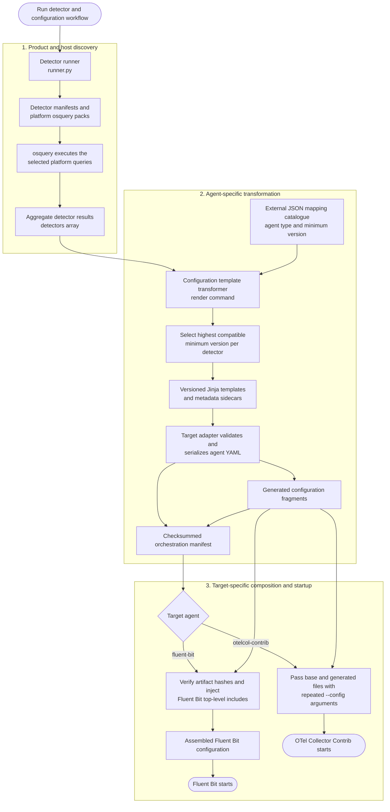

<!--
Copyright 2026 opamp.info
Licensed under the Apache License, Version 2.0.
-->

# Configuration generation execution flow

## End-to-end flow

This diagram shows the path from detector execution through deployment-ready
observability-agent configuration.

The detector runner and transformer remain separate processes. Detector results
are the versioned handoff between discovery and configuration generation; the
orchestration manifest is the checksummed handoff between generation and
deployment.

## Detailed transformer flow

This diagram expands the `render` command, including its explicit-definition
compatibility path and the normal agent-mapping path.

```mermaid
flowchart TD
    cli([render command])
    source_choice{"Exactly one source supplied?"}
    input_error([Log validation error and exit 1])
    load_results["Load detector-results JSON"]
    validate_results["Validate optional external schema<br/>and require detectors array"]
    parse_version["Parse target version with PEP 440"]
    source_type{"Transformation source"}

    cli --> source_choice
    source_choice -->|No or both| input_error
    source_choice -->|Yes| load_results
    load_results --> validate_results
    validate_results --> parse_version
    parse_version --> source_type

    subgraph definitions["Definition discovery and compatibility selection"]
        load_yaml["Load and schema-validate each<br/>explicit YAML transform"]
        scan_json["Recursively scan mapping root<br/>for JSON resources"]
        validate_mapping["Validate every agent mapping<br/>against the packaged schema"]
        filter_mapping["Filter by detector name and<br/>requested agent type"]
        compare_floor["Keep minimum versions less than<br/>or equal to target version"]
        select_floor["For each detector select the unique<br/>highest compatible floor"]
        selection_error(["Missing compatible floor or<br/>equal best floors: exit 1"])
        normalize["Normalize mapping into an immutable<br/>transform definition"]

        source_type -->|--definition| load_yaml
        source_type -->|--mapping-root| scan_json
        scan_json --> validate_mapping
        validate_mapping --> filter_mapping
        filter_mapping --> compare_floor
        compare_floor --> select_floor
        select_floor -->|Missing or ambiguous| selection_error
        select_floor -->|Unique match| normalize
    end

    common_adapter["Require one target tool and<br/>resolve its adapter"]
    definition_loop{"Next selected definition"}
    check_target["Check target version constraint"]
    load_template["Resolve template and metadata paths<br/>inside the approved template root"]
    check_metadata["Validate metadata schema, identity,<br/>API, tool, version and capabilities"]
    detector_state{"Matching detector is<br/>present, detected and error-free?"}
    empty_plugins["Use an empty plugin list and<br/>record the selection status"]

    load_yaml --> common_adapter
    normalize --> common_adapter
    common_adapter --> definition_loop
    definition_loop --> check_target
    check_target --> load_template
    load_template --> check_metadata
    check_metadata --> detector_state

    subgraph rules["JSONPath rule normalization"]
        rule_loop{"Next rule and selected row"}
        static_values["Copy static values"]
        dynamic_fields["Resolve fields_from selectors<br/>as singular dynamic values"]
        field_state{"Dynamic field result"}
        skip_row["Skip row"]
        path_choice{"path_from configured?"}
        resolve_paths["Resolve, trim and reject<br/>empty path values"]
        deduplicate["Canonicalize and deduplicate<br/>plugin objects"]
        enforce_limit["Enforce maximum plugin count"]
        more_rows{"More rules or rows?"}

        detector_state -->|Yes| rule_loop
        rule_loop --> static_values
        static_values --> dynamic_fields
        dynamic_fields --> field_state
        field_state -->|Missing| skip_row
        field_state -->|Multiple| input_error
        field_state -->|One value per field| path_choice
        path_choice -->|Yes| resolve_paths
        path_choice -->|No| deduplicate
        resolve_paths --> deduplicate
        deduplicate --> enforce_limit
        enforce_limit --> more_rows
        skip_row --> more_rows
        more_rows -->|Yes| rule_loop
    end

    detector_state -->|No| empty_plugins
    render["Render with immutable sandboxed Jinja<br/>and strict undefined values"]
    parse_yaml["Enforce rendered byte limit<br/>and parse as a YAML mapping"]
    serialize["Adapter validates target structure<br/>and serializes deterministic YAML"]
    write_artifact["Atomically write artifact and<br/>calculate SHA-256 provenance"]
    more_definitions{"More definitions?"}
    build_manifest["Build target, source, template,<br/>artifact and include records"]
    validate_manifest["Validate manifest schema"]
    write_manifest["Atomically write orchestration JSON"]
    success([Exit 0])

    more_rows -->|No| render
    empty_plugins --> render
    render --> parse_yaml
    parse_yaml --> serialize
    serialize --> write_artifact
    write_artifact --> more_definitions
    more_definitions -->|Yes| definition_loop
    more_definitions -->|No| build_manifest
    build_manifest --> validate_manifest
    validate_manifest --> write_manifest
    write_manifest --> success
```

Any schema, path, JSONPath, version, template, size, plugin-count, or adapter
validation failure follows the error outcome and returns a non-zero CLI status.
Artifact files and the final manifest are written atomically.
